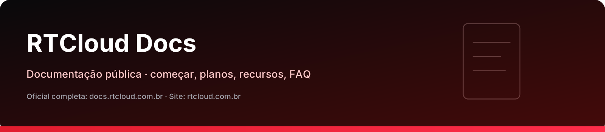
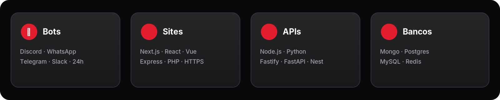

  

# RTCloud Docs

**Hospedagem de bots, sites e APIs com potência e simplicidade.**

Deploy em minutos · painel em português · Pix Automático · subdomínios `*.rtsystems.app` · AMD EPYC · NVMe · DDoS.

  <a href="https://docs.rtcloud.com.br">Docs oficial (completa)</a>
  <a class="secondary" href="https://rtcloud.com.br">Site rtcloud.com.br</a>
  <a class="secondary" href="https://rtcloud.com.br/planos">Ver planos</a>
  <a class="secondary" href="https://status.rtcloud.com.br">Status</a>

!!! tip "Documentação oficial"
    Este espelho no GitHub Pages resume o essencial. A documentação **completa** (90+ artigos) e a referência da API ficam em **[docs.rtcloud.com.br](https://docs.rtcloud.com.br)**.

## Comece por aqui

  <a href="inicio/primeiro-deploy/"><strong>🚀 Primeiro deploy</strong>Criar conta e subir sua app</a>
  <a href="inicio/o-que-hospedar/"><strong>📦 O que hospedar</strong>Bots, sites, APIs e bancos</a>
  <a href="planos/"><strong>💳 Planos</strong>A partir de R$ 16,24/mês</a>
  <a href="recursos/"><strong>✨ Recursos</strong>Painel, ReactorAI, MCP, Blob</a>
  <a href="novidades/"><strong>📰 Novidades</strong>Changelog oficial (v5.2…)</a>
  <a href="faq/"><strong>❓ FAQ</strong>Perguntas frequentes</a>
  <a href="suporte/"><strong>💬 Suporte</strong>WhatsApp, Discord, e-mail</a>

## Em uma frase

A RTCloud é uma hospedagem brasileira para **bots** (Discord, WhatsApp, Telegram, Slack), **sites**, **APIs** e **bancos dedicados**, com pagamento por **Pix Automático** e suporte em português.

## Links rápidos

| | |
|:--|:--|
| Painel / registro | [rtcloud.com.br/register](https://rtcloud.com.br/register) |
| Planos | [rtcloud.com.br/planos](https://rtcloud.com.br/planos) |
| **Documentação oficial** | [docs.rtcloud.com.br](https://docs.rtcloud.com.br) |
| API pública | [docs.rtcloud.com.br/referencia-api](https://docs.rtcloud.com.br/referencia-api) |
| Status | [status.rtcloud.com.br](https://status.rtcloud.com.br) |
| Org GitHub | [github.com/rtcloud-br](https://github.com/rtcloud-br) |

!!! note "Mantenedor"
    Plataforma construída e mantida por **[RTPySystems](https://github.com/RTPySystems)**.
